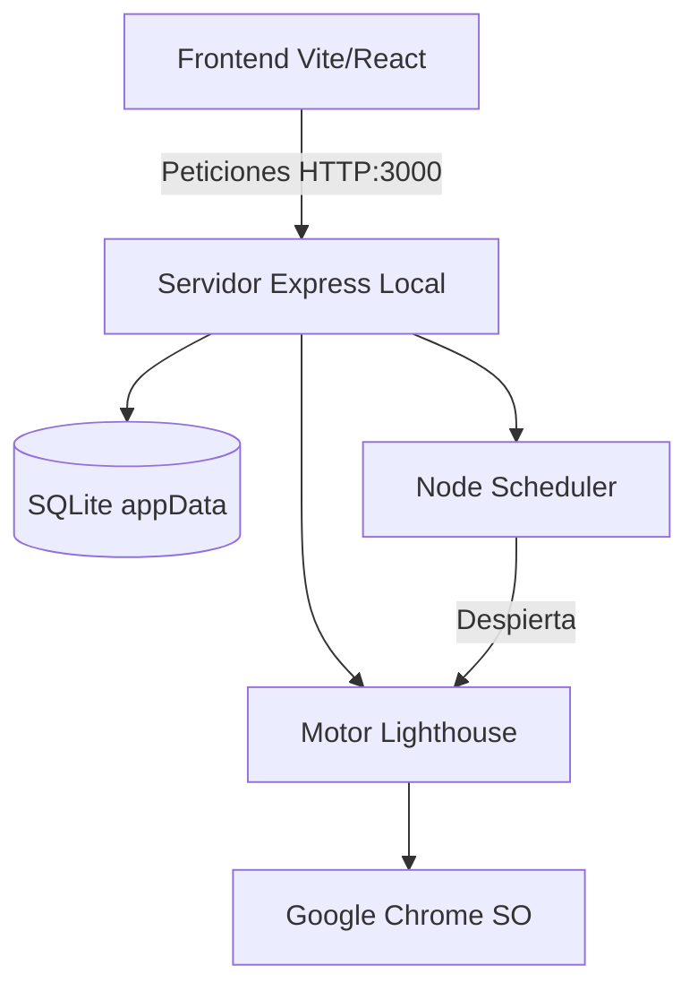

# WPO Analytics Engine v2.0.0 🚀
**The Desktop Edition (Electron + Vite + Express + SQLite)**

Bienvenido a la versión definitiva del WPO Analytics Engine. Hemos evolucionado la arquitectura original basada en contenedores Docker hacia una **aplicación nativa de escritorio independiente y distribuible**, manteniendo toda la potencia del motor Lighthouse y la interfaz moderna de React.

---

## 🎯 Resumen de la Nueva Versión

El gran hito de la versión 2.0.0 es la consolidación del clúster de microservicios (Frontend, Backend, y Redis/Cola) en un único empaquetado **.exe** capaz de correr de manera local sin necesidad de configuraciones de red, contenedores o herramientas de línea de comandos.

### Características Principales:
1. **Lighthouse Integrado**: Sustitución de `puppeteer` por `chrome-launcher` para usar la instalación nativa de Chrome del sistema, reduciendo el consumo de memoria drásticamente.
2. **Web Crawler Integrado**: Rastreo de enlaces internos automáticos mediante un motor basado en `cheerio` para auditorías en lote directas.
3. **Privacidad y Aislamiento de Datos**: La base de datos SQLite ya no se comparte en la nube ni en el código fuente. Cada instalación genera su propia BBDD limpia en el directorio protegido del usuario (`%APPDATA%\wpo-engine\wpo-historics.sqlite`).
4. **Programador de Tareas Autónomo**: Hemos sustituido la pesada dependencia de BullMQ y Redis por un planificador de crons en memoria nativo de Node.js que opera en segundo plano dentro de la app de escritorio.
5. **UI Neutra y Profesional**: Los placeholders de interfaz han sido estandarizados (`tutienda.com`, `alertas@tutienda.com`) para permitir la distribución y uso como marca blanca o herramienta de agencia.

---

## 🏗️ Arquitectura Técnica

El sistema utiliza un enfoque híbrido (Server-Side Rendering embebido):



1. **Electron Main Process**: Actúa como un contenedor que enciende un servidor **Express.js** en el puerto `3000`. Esto permite reutilizar el 90% del código original del Backend de Docker sin tener que migrar toda la lógica de los controladores a comunicación IPC estricta.
2. **Electron Renderer**: Utiliza la SPA compilada con **Vite**. Al detectar el entorno de escritorio, las peticiones HTTP (como el crawler o la cola) viajan directamente a `127.0.0.1:3000` en vez de buscar un orquestador externo.
3. **Asar Unpacking**: La dependencia crítica nativa de `sqlite3` se desempaqueta fuera del archivo de sólo lectura `app.asar` para evitar los errores de permisos (ReadOnly) comunes en Windows.

---

## 📦 Instrucciones de Distribución y Uso

### Compartir con Compañeros
Para distribuir esta herramienta, **no necesitas enviar el código fuente**.
1. Simplemente localiza el archivo generado: `C:\WPO-Build\release\WPO Engine Setup 2.0.0.exe`.
2. Súbelo a Google Drive, compártelo por WeTransfer o añádelo como un `Release` oficial en GitHub.
3. Tus compañeros de trabajo o clientes solo necesitan instalar el `.exe`.

> [!IMPORTANT]
> **Privacidad Asegurada:** Cuando un compañero instale la app, Electron detectará su perfil de Windows y generará una base de datos vacía y privada en *su* disco. ¡Tus métricas de auditorías locales o credenciales no están dentro del instalador!

### Subida Segura a GitHub (Repositorio)
El proyecto ha sido desinfectado y está listo para hacer `git commit` y `git push`.
Se han aplicado las siguientes medidas de seguridad en el `.gitignore`:
- Las carpetas de compilación pesadas (`frontend/dist-electron`, `frontend/release`, `C:\WPO-Build`) se omiten.
- Las bases de datos SQLite y los archivos temporales de registro WAL (`db/*.sqlite`) están bloqueados.
- Las variables de entorno de secretos (si las hubiera en un futuro) están ocultas.

**Comandos a ejecutar en tu terminal local para subir a GitHub:**
```bash
git add .
git commit -m "🚀 feat: Lanzamiento WPO Engine v2.0.0 (Desktop Edition)"
git push origin main
```

---

## ⚖️ Estándares y Pruebas de Calidad (QA)

Durante la "Fase de Jefe Final" de empaquetado, hemos superado los siguientes puntos de fricción estándar de la industria:
- **Code Signing Timeout**: Evadimos el chequeo de certificados de firma de código en la generación del instalador NSIS para permitir una compilación sin errores para aplicaciones open source o de distribución interna.
- **Node-GYP / N-API compatibility**: Las dependencias problemáticas como `bullmq` / `msgpackr` fueron neutralizadas y `sqlite3` se configuró para compilarse acorde al módulo nativo C++ de Node v36 de la versión de Electron utilizada.
- **Rutas Relativas en SPA**: Ajustado el proxy HTTP para soportar peticiones a la API desde el protocolo `file://` del escritorio evitando bloqueos CORS o `Failed to Fetch`.
