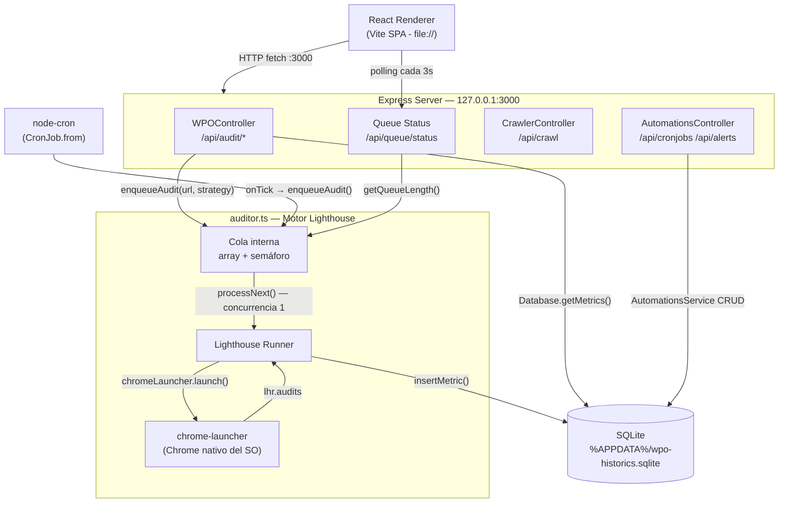

**Documentación técnica →** [Arquitectura](./architecture.md) · [Dashboard](./dashboard.md) · [Automations](./automations.md) · [Herramientas internas](./internal-tools.md)

---

# Arquitectura Global — WPO Analytics Engine v2.0.0

## Visión General

WPO Analytics Engine es una aplicación de escritorio (Electron) que embebe un servidor Express.js completo. El renderer (React/Vite) actúa como cliente HTTP de ese servidor local, eliminando la necesidad de red externa, Docker o Redis.

El proceso de arranque es secuencial y determinista:

```
app.whenReady()
  └─ 1. startExpressServer()    → inyecta WPO_DB_PATH, levanta Express en :3000
  └─ 2. startCronScheduler()    → lee tabla `cronjobs`, registra CronJobs activos
  └─ 3. createWindow()          → carga dist/index.html (Vite SPA)
```

---

## Flujo de Datos Global



---

## Módulos del Proceso Principal (`electron/main.ts`)

### `startExpressServer()`

Responsabilidades (en orden):

1. **Inyecta** `process.env.WPO_DB_PATH` con la ruta `app.getPath('userData') + '/wpo-historics.sqlite'` **antes** de cualquier `import` que abra la base de datos. Esto garantiza que `Database` y `AutomationsService` usen la ruta correcta del perfil de Windows.
2. Importa dinámicamente (`await import`) todos los controladores para respetar el orden de las variables de entorno.
3. Arranca Express en `127.0.0.1:3000` (solo loopback — no expuesto a la red local).

**Middlewares registrados:** `cors()`, `compression()`, `express.json({ limit: '10mb' })`.

### `startCronScheduler()`

Lee la tabla `cronjobs` de SQLite mediante `AutomationsService.getCronjobs()`, filtra los registros con `active = 1` y crea un `CronJob.from()` por cada uno.

- Zona horaria fija: `Europe/Madrid`.
- En cada tick, llama a `enqueueAudit(cj.url, cj.strategy)`.
- Errores de ejecución se registran en consola; no cancelan el scheduler ni el job siguiente.
- **Limitación actual:** el scheduler solo se carga al inicio de la app. Un cambio en la tabla `cronjobs` (add/toggle/delete) **no recarga automáticamente** los jobs en memoria hasta el próximo arranque.

---

## Capa de Auditoría (`electron/auditor.ts`)

### Cola Interna

```typescript
let isRunning = false;   // semáforo de concurrencia (máx 1)
const queue: AuditJob[] = [];
```

**`enqueueAudit(url, strategy)`**

| Parámetro  | Tipo                     | Default    |
|------------|--------------------------|------------|
| `url`      | `string`                 | —          |
| `strategy` | `'mobile' \| 'desktop'`  | `'mobile'` |

- Retorna: `Promise<AuditMetrics>` que resuelve cuando Lighthouse escribe en SQLite.
- Empuja un `AuditJob` con `resolve` y `reject` al array `queue[]`, luego llama a `processNext()`.
- Si ya hay una auditoría en curso (`isRunning === true`), el job **espera** en cola. No hay timeout de espera.

**`getQueueLength()`**

Retorna `queue.length + (isRunning ? 1 : 0)`. Incluye el job en ejecución.

### `runAudit(job)`

1. Lanza Chrome con `chromeLauncher.launch({ chromeFlags: ['--headless=new', '--no-sandbox', ...] })`.
2. Ejecuta Lighthouse con `onlyCategories: ['performance']` — el resto de categorías (a11y, SEO, best-practices) **no se auditan**.
3. Emulación de pantalla según `strategy`:

| strategy  | width | height | deviceScaleFactor |
|-----------|-------|--------|-------------------|
| `mobile`  | 412   | 823    | 1.75              |
| `desktop` | 1350  | 940    | 1                 |

4. Extrae métricas del objeto `result.lhr.audits`:

| Campo     | Audit key de Lighthouse           |
|-----------|-----------------------------------|
| `ttfb`    | `server-response-time.numericValue` |
| `lcp`     | `largest-contentful-paint.numericValue` |
| `cls`     | `cumulative-layout-shift.numericValue` |
| `tbt`     | `total-blocking-time.numericValue` |
| `domSize` | `dom-size.numericValue`           |

5. Llama a `insertMetric()` para escribir en SQLite. Si el insert falla, rechaza la Promise y logea el error. Chrome se mata **siempre** en el bloque `finally` para evitar procesos huérfanos.

### `insertMetric()`

Abre una **nueva** conexión SQLite por cada inserción (no comparte la instancia del módulo `Database`). La columna `screenshot_base64` se inserta siempre como `null`.

---

## Capa de Persistencia (`api/src/models/database.ts`)

Base de datos SQLite con `PRAGMA journal_mode = WAL` habilitado. La ruta se resuelve con esta prioridad:

1. `process.env.WPO_DB_PATH` (Electron — inyectado por `main.ts`)
2. Ruta relativa de desarrollo local
3. `/app/db/wpo-historics.sqlite` (Docker — legacy)

### Esquema de tablas

**`metrics`**

| Columna             | Tipo    | Notas                              |
|---------------------|---------|------------------------------------|
| `id`                | INTEGER | PK AUTOINCREMENT                  |
| `url`               | TEXT    |                                    |
| `timestamp`         | INTEGER | Unix epoch en ms                  |
| `ttfb`              | REAL    | ms                                 |
| `lcp`               | REAL    | ms                                 |
| `cls`               | REAL    | puntuación 0.0–∞                  |
| `tbt`               | REAL    | ms                                 |
| `domSize`           | INTEGER | número de nodos DOM               |
| `is_baseline`       | INTEGER | 0 \| 1, default 0                 |
| `strategy`          | TEXT    | 'mobile' \| 'desktop'             |
| `screenshot_base64` | TEXT    | siempre NULL en v2.0              |

**`cronjobs`** / **`alerts`** — ver [`automations.md`](./automations.md).

---

## API REST — Tabla de Endpoints

| Método | Ruta                         | Controlador                     | Descripción                          |
|--------|------------------------------|---------------------------------|--------------------------------------|
| GET    | `/api/audit/metrics`         | `WPOController.getMetrics`      | Últimos 50 registros + baseline join |
| GET    | `/api/audit/all`             | `WPOController.getAllMetrics`   | Historial completo (sin límite)      |
| GET    | `/api/audit/history`         | `WPOController.getHistory`      | Promedio 7 días (time-series)        |
| POST   | `/api/audit/ondemand`        | Express inline en `main.ts`     | Encola auditoría bajo demanda        |
| POST   | `/api/audit/batch`           | Express inline en `main.ts`     | Encola hasta 50 URLs                 |
| POST   | `/api/audit/baseline`        | `WPOController.setBaseline`     | Marca ID como baseline               |
| DELETE | `/api/audit/:id`             | `WPOController.deleteAudit`     | Elimina registro por ID              |
| GET    | `/api/queue/status`          | Express inline en `main.ts`     | Contadores de la cola interna        |
| POST   | `/api/queue/clean-failed`    | Express inline en `main.ts`     | No-op en modo Electron               |
| GET    | `/api/crawl`                 | `CrawlerController.crawl`       | Extrae URLs internas de una página   |
| GET    | `/api/cronjobs`              | `AutomationsController`         | Lista cronjobs                       |
| POST   | `/api/cronjobs`              | `AutomationsController`         | Crea cronjob                         |
| PATCH  | `/api/cronjobs/:id/toggle`   | `AutomationsController`         | Activa/desactiva cronjob             |
| DELETE | `/api/cronjobs/:id`          | `AutomationsController`         | Elimina cronjob                      |
| GET    | `/api/alerts`                | `AutomationsController`         | Lista alertas                        |
| POST   | `/api/alerts`                | `AutomationsController`         | Crea alerta                          |
| DELETE | `/api/alerts/:id`            | `AutomationsController`         | Elimina alerta                       |

---

## Configuración de Build (`frontend/vite.config.ts`)

El flag `ELECTRON=true` en la variable de entorno activa el plugin `vite-plugin-electron/simple`. En modo Electron:

- El proceso principal (`electron/main.ts`) se compila en formato ES Module (`[name].mjs`) con **todos los imports no-relativos como externos** (`external: (id) => !id.startsWith('.')...`). Esto evita bundlear `sqlite3`, `express`, `cheerio`, etc. — Node.js los resuelve desde `node_modules` en runtime.
- La variable `__ELECTRON_MODE__` se define como `true` y queda expuesta al renderer para que `api.ts` use `http://127.0.0.1:3000` en lugar de rutas relativas.
- En modo Docker (sin `ELECTRON=true`), el proxy de Vite redirige `/api` al contenedor `api-orchestrator:3000`.
