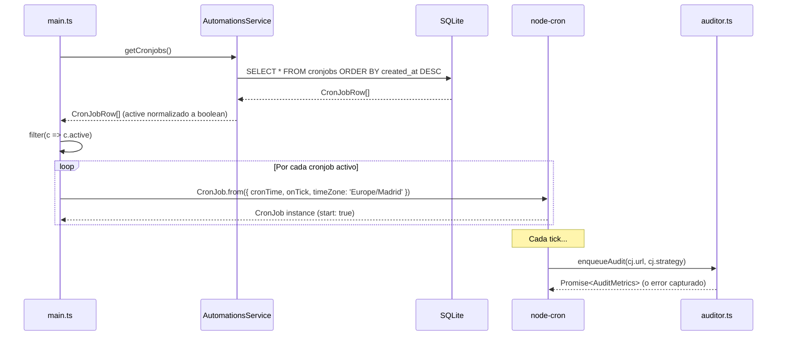

**Documentación técnica →** [Arquitectura](./architecture.md) · [Dashboard](./dashboard.md) · [Automations](./automations.md) · [Herramientas internas](./internal-tools.md)

---

# Automations — Documentación Técnica

## Visión General

La pestaña Automations gestiona dos subsistemas independientes:

1. **Cronjobs** — Auditorías periódicas programadas mediante expresiones cron.
2. **Alerts** — Umbrales de métricas que desencadenan notificaciones por email (definición en BD; la lógica de envío es un roadmap pendiente).

Ambos subsistemas comparten la misma instancia de SQLite a través de `AutomationsService`.

---

## Arquitectura de Capas

```
AutomationsView (React)
    └── api.ts (fetch helpers)
        └── AutomationsController (Express)
            └── AutomationsService (SQLite CRUD)
                └── SQLite: tablas `cronjobs` y `alerts`

main.ts → startCronScheduler()
    └── AutomationsService.getCronjobs()
    └── CronJob.from() por cada row activa
        └── onTick → enqueueAudit(url, strategy)
```

---

## Subsistema Cronjobs

### Esquema de Tabla

```sql
CREATE TABLE IF NOT EXISTS cronjobs (
    id              INTEGER PRIMARY KEY AUTOINCREMENT,
    url             TEXT    NOT NULL,
    strategy        TEXT    NOT NULL DEFAULT 'mobile',
    cron_expression TEXT    NOT NULL,
    active          INTEGER NOT NULL DEFAULT 1,  -- SQLite boolean: 0 | 1
    created_at      DATETIME DEFAULT (datetime('now'))
)
```

SQLite almacena `active` como `INTEGER`. `AutomationsService` normaliza el valor a `boolean` en cada lectura:

```typescript
return rows.map(r => ({ ...r, active: r.active === 1 }));
```

### API Endpoints

#### `GET /api/cronjobs`

- Retorna: `{ data: CronJobRow[] }` — ordenado por `created_at DESC`.
- Error: `500` si falla SQLite.

#### `POST /api/cronjobs`

**Request body:**

| Campo             | Tipo     | Validación                                                              |
|-------------------|----------|-------------------------------------------------------------------------|
| `url`             | `string` | Debe ser una URL válida (parsed con `new URL()`). Error 400 si no.     |
| `strategy`        | `string` | Debe ser `"mobile"` o `"desktop"`. Error 400 si no.                    |
| `cron_expression` | `string` | Debe tener exactamente 5 campos separados por espacios (regex `/^(\S+\s){4}\S+$/`). Error 400 si no. |

**Response exitoso (`201`):**

```json
{
  "data": {
    "id": 3,
    "url": "https://tutienda.com",
    "strategy": "mobile",
    "cron_expression": "0 3 * * 1-5",
    "active": true,
    "created_at": "2026-05-20 13:00:00"
  }
}
```

El nuevo cronjob se inserta con `active = 1` (habilitado por defecto).

> ⚠️ **Limitación:** Crear un cronjob vía API **no registra automáticamente el `CronJob` en el scheduler en memoria**. El scheduler solo se carga al inicio de la app (`startCronScheduler()`). El nuevo job solo comenzará a ejecutarse en el próximo arranque de la aplicación.

#### `PATCH /api/cronjobs/:id/toggle`

**Request body:**

| Campo    | Tipo      | Validación                          |
|----------|-----------|-------------------------------------|
| `active` | `boolean` | Requerido. Error 400 si no boolean. |

- Response exitoso: `200 { success: true }`.
- Error `404`: si `changes === 0` (ID no existe).
- Error `400`: si `:id` no es un número o `active` no es boolean.

#### `DELETE /api/cronjobs/:id`

- Response exitoso: `204 No Content`.
- Error `404`: si `changes === 0` (ID no existe).

---

### Scheduler en Runtime (`main.ts → startCronScheduler()`)



**Parámetros de `CronJob.from()`:**

| Parámetro   | Valor                              |
|-------------|-------------------------------------|
| `cronTime`  | `cj.cron_expression` (string 5 campos) |
| `onTick`    | Función async que llama `enqueueAudit` |
| `start`     | `true` — el job arranca inmediatamente |
| `timeZone`  | `'Europe/Madrid'`                   |

**Manejo de errores en `onTick`:**

Los errores se capturan en `.catch()` y se logean con `console.error('[Cron] Error ...')`. El job no se elimina ni pausa ante fallos. El siguiente tick se ejecutará igualmente.

---

## Subsistema Alerts

### Esquema de Tabla

```sql
CREATE TABLE IF NOT EXISTS alerts (
    id          INTEGER PRIMARY KEY AUTOINCREMENT,
    email       TEXT NOT NULL,
    device      TEXT NOT NULL DEFAULT 'both',
    thresholds  TEXT NOT NULL,   -- JSON serializado: {"lcp": 2500, "score": 80}
    created_at  DATETIME DEFAULT (datetime('now'))
)
```

El campo `thresholds` se almacena como `TEXT` (JSON stringify). `AutomationsService` lo deserializa en cada lectura:

```typescript
thresholds: JSON.parse(r.thresholds ?? '{}') as MetricThresholds
```

### API Endpoints

#### `POST /api/alerts`

**Request body:**

| Campo        | Tipo                         | Validación                                                                            |
|--------------|------------------------------|---------------------------------------------------------------------------------------|
| `email`      | `string`                     | Regex `/^[^\s@]+@[^\s@]+\.[^\s@]+$/`. Error 400 si no válido.                       |
| `device`     | `string`                     | Debe ser `"mobile"`, `"desktop"` o `"both"`. Error 400 si no.                       |
| `thresholds` | `Record<AlertMetric, number>`| Al menos una clave. Claves válidas: `score`, `lcp`, `ttfb`, `cls`, `tbt`. Valores deben ser `number >= 0`. Error 400 si no. |

**Response exitoso (`201`):**

```json
{
  "data": {
    "id": 1,
    "email": "alertas@tutienda.com",
    "device": "both",
    "thresholds": { "score": 60, "lcp": 4000 },
    "created_at": "2026-05-20 13:00:00"
  }
}
```

#### `GET /api/alerts`

- Retorna: `{ data: AlertRow[] }` — ordenado por `created_at DESC`.
- `thresholds` ya viene deserializado como objeto.

#### `DELETE /api/alerts/:id`

- Response exitoso: `204 No Content`.
- Error `404`: si no existe.

> ⚠️ **Funcionalidad pendiente:** Las alertas se guardan en BD pero **no hay lógica de evaluación ni envío de email** implementada en v2.0.0. El sistema de notificaciones es un roadmap para v2.5.

---

## Tipos Exportados (`automations.service.ts`)

```typescript
type Strategy    = 'mobile' | 'desktop';
type AlertDevice = 'mobile' | 'desktop' | 'both';
type AlertMetric = 'score' | 'lcp' | 'ttfb' | 'cls' | 'tbt';
type MetricThresholds = Partial<Record<AlertMetric, number>>;

interface CronJobRow {
    id: number;
    url: string;
    strategy: Strategy;
    cron_expression: string;
    active: boolean;          // normalizado desde INTEGER
    created_at: string;
}

interface AlertRow {
    id: number;
    email: string;
    device: AlertDevice;
    thresholds: MetricThresholds;  // deserializado desde JSON
    created_at: string;
}
```

---

## Validaciones del Controlador (sin librerías externas)

| Regla                  | Implementación                                 |
|------------------------|------------------------------------------------|
| URL válida             | `try { new URL(value) } catch { return false }`|
| Strategy válida        | `['mobile', 'desktop'].includes(strategy)`     |
| Cron válida (5 campos) | `/^(\S+\s){4}\S+$/`                           |
| Email válido           | `/^[^\s@]+@[^\s@]+\.[^\s@]+$/`               |
| Métrica válida         | `['score','lcp','ttfb','cls','tbt'].includes(k)`|
| Umbral numérico        | `typeof v !== 'number' \|\| isNaN(v) \|\| v < 0`|
